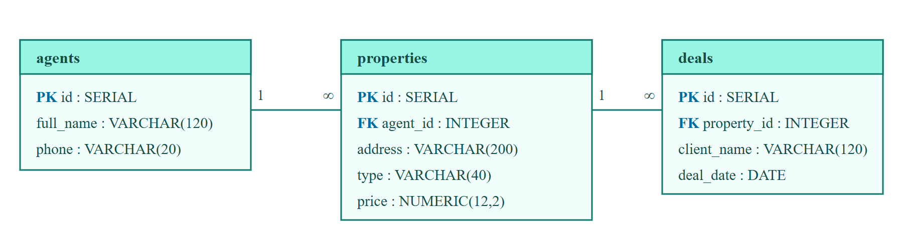
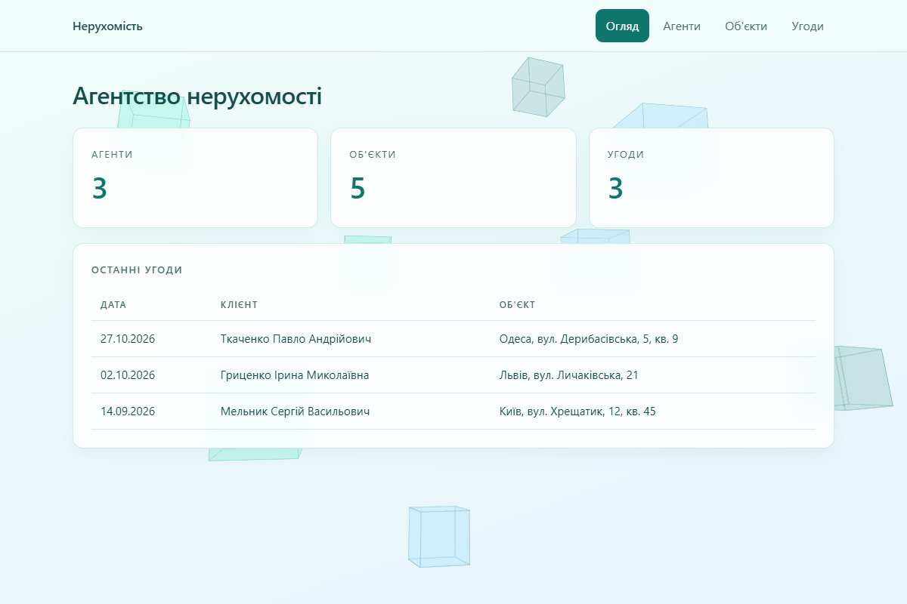
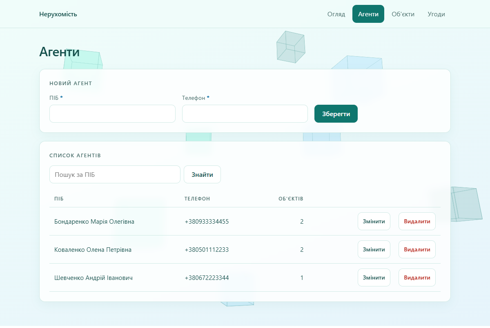
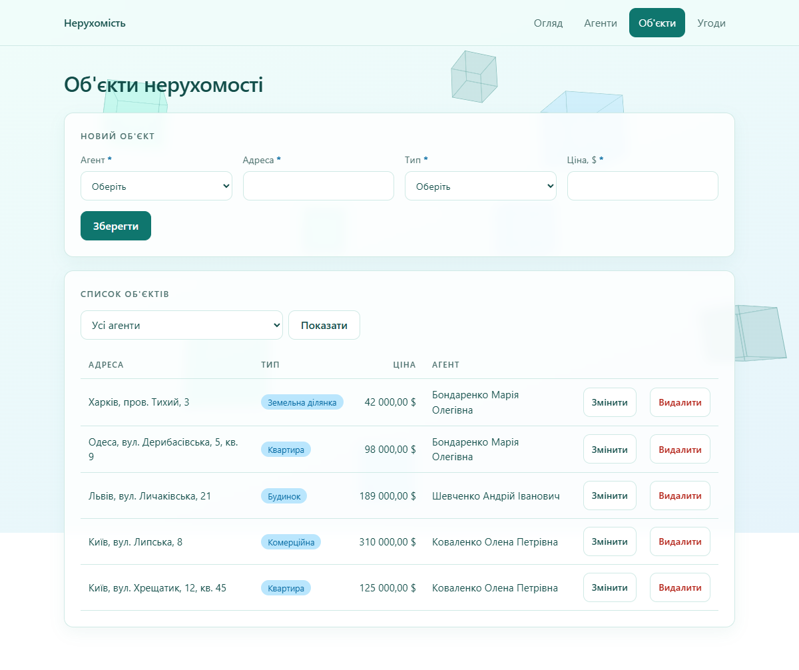
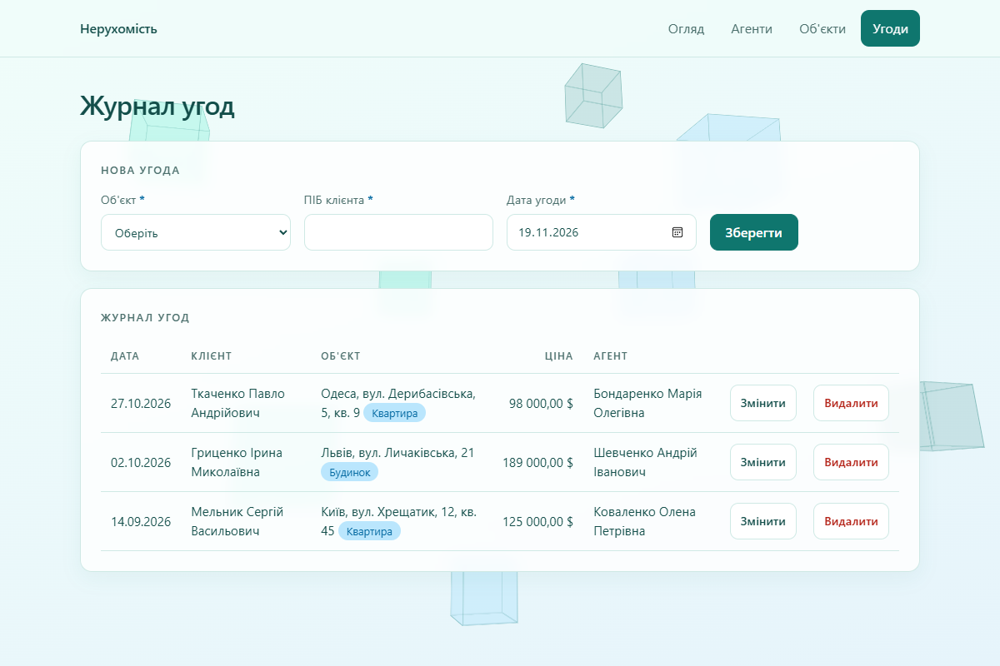
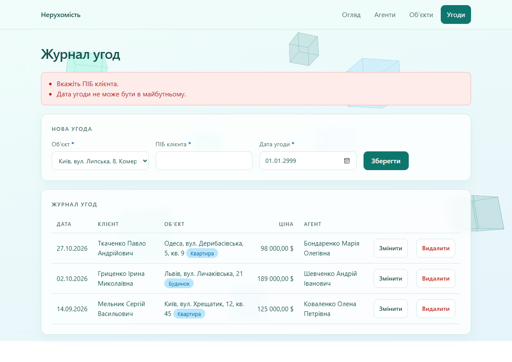

# Агентство нерухомості

Практическая работа №7 по дисциплине «Программирование Интернет», вариант 18. Веб-приложение на PHP с базой данных PostgreSQL для учёта агентов, объектов недвижимости и сделок.

## Что умеет

Агентов и объекты можно добавлять, менять и удалять. Объект привязывается к агенту. Сделки оформляются, редактируются и удаляются, а журнал сделок показывает клиента, объект и агента. Есть поиск агента по ФИО и фильтр объектов по агенту.

Списки открываются методом GET, изменения идут через POST. Все запросы к базе подготовленные. Обязательные поля, цена и дата проверяются на сервере, после каждой операции показывается сообщение. Агента с объектами и объект со сделками удалить нельзя.

## Запуск

Нужен Docker.

```
docker compose up -d
```

Сайт откроется на http://localhost:8080. База создаётся и заполняется тестовыми данными из `schema.sql` при первом запуске. Чтобы сбросить данные:

```
docker compose down -v
```

## Структура

| Файл | Назначение |
| --- | --- |
| `db.php` | подключение к базе и общие функции |
| `index.php` | главная страница |
| `agents.php` | агенты |
| `properties.php` | объекты недвижимости |
| `deals.php` | сделки |
| `header.php`, `footer.php` | общий шаблон |
| `assets/` | стили и скрипт с 3D-фоном |
| `schema.sql` | таблицы и тестовые данные |

## Схема базы данных



## Скриншоты

Главная страница



Агенты



Объекты недвижимости



Журнал сделок



Проверка полей


